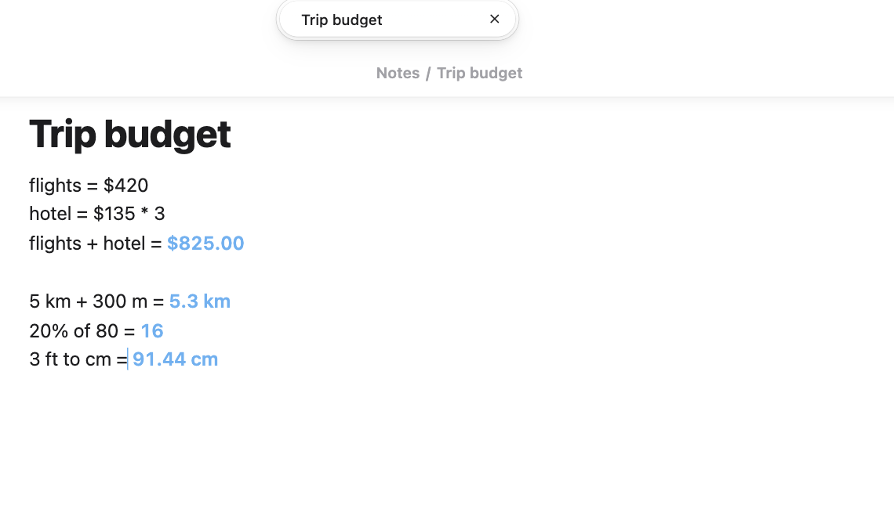

# Tahoe Math

**A calculator in your notes.** Type an expression ending in `=` and the answer appears right after it, as you type. No code block and no special syntax: it works in ordinary text.



- `5 km + 300 m =` → **5.3 km**
- `flights = $420`, `hotel = $135 * 3`, then `flights + hotel =` → **$825.00**
- `f(t) = t^2 + 1` then `f(4) =` → **17**

## What it understands

| You type | You see |
| --- | --- |
| `x = 12` then `x * 3.5 =` | `42` |
| `5 km + 300 m =` | `5.3 km` |
| `3 ft to cm =` | `91.44 cm` |
| `72 degF to degC =` | `22.222 degC` |
| `20% of 80 =` | `16` |
| `$12.50 * 4 =` | `$50.00` |
| `f(t) = t^2 + 1` then `f(4) =` | `17` |
| `daysUntil("Dec 25") =` | the days left |

Variables and functions carry down the note, so later lines can use earlier ones. Answers are worked out exactly by [math.js](https://mathjs.org), not guessed.

## Using it

- **Answers show as you type.** Nothing is written into your note until you want it.
- **Keep an answer:** click it, or press Tab at the end of the line, and it's written in.
- **Write every answer in at once:** run *Write all answers into this note* from the command palette.
- **Reading view** shows the answers too.
- **Only where you want it:** turn on *Only in notes marked for maths* in the settings, then add `math: true` to the properties of the notes that should show answers.
- **Precision:** choose how many significant digits answers show.
- **Multiplication just works:** Obsidian normally pairs a typed `*` for italics; in a line of maths, Tahoe Math keeps it a single `*`.

It uses nothing desktop-only, so it runs in Obsidian on phones and tablets too.

### Questions in plain English (optional)

With the companion plugin Tahoe Intelligence (Mac only, not in the community directory yet), you can also type questions like `days until Oct 14 =` or `20% tip on $86 split 3 ways =`. An on-device model rewrites the question as a calculation, and Tahoe Math works it out exactly. These answers are marked with ✦. Without Tahoe Intelligence, everything else works as normal.

## Disclosures

- **No network use.** Tahoe Math works entirely offline.
- **No files outside your vault.** Its settings, and any plain-English rewrites, are saved in the plugin's own data in your vault.
- **No telemetry, ads, accounts or payments.**

<!-- tahoe-family -->
## The Tahoe family

Tahoe is a set of plugins and a theme that work on their own and fit together.

| | | |
| --- | --- | --- |
| **[Tahoe Run](https://github.com/krishnanefx/obsidian-tahoe-run)** | Run the code in your notes, like a notebook: Python with a debugger and variables view, MATLAB, and ~25 other languages. | available |
| **Tahoe Math** | A calculator in your notes: type an expression ending in `=` and the answer appears. | this one |
| **[Tahoe](https://github.com/krishnanefx/obsidian-tahoe-theme)** | A clean, Mac-like theme, in light and dark. | available |
| **[Tahoe Code](https://github.com/krishnanefx/obsidian-tahoe-code)** | An IDE in your code blocks: suggestions, checking as you type, quick fixes, go to definition, formatting and AI edits. | available |
| **Tahoe Glass** | Real refraction for the Tahoe theme's glass, and System Settings–style settings pages. | coming soon |
| **[Tahoe Organize](https://github.com/krishnanefx/obsidian-tahoe-organize)** | Keep a growing vault tidy: inbox triage, smart folders, colored tags, link suggestions, vault health, literature notes and text from images. | available |
| **Tahoe Intelligence** | On-device AI for your notes: ask your notes, related notes, distilling permanent notes and more. | coming soon |

**Better together**

- **With Tahoe Intelligence (coming soon):** ask in words: `days until Oct 14 =` or `20% tip on $86 split 3 ways =`. An on-device model turns the question into a calculation, and Tahoe Math works it out exactly.
- **With [Tahoe Run](https://github.com/krishnanefx/obsidian-tahoe-run):** when a calculation outgrows a line, a Python block in the same note picks up from there, with variables that carry across blocks.
- **With [Tahoe](https://github.com/krishnanefx/obsidian-tahoe-theme):** answers take your accent colour, in Tahoe or any theme.
<!-- /tahoe-family -->

## Credits

[math.js](https://github.com/josdejong/mathjs) by Jos de Jong does the arithmetic, under the Apache License 2.0. See [THIRD_PARTY_NOTICES.md](THIRD_PARTY_NOTICES.md).

Tahoe Math is an independent project. It isn't affiliated with, or endorsed by, Apple.

## License

[MIT](LICENSE) © 2026 Krishnan Adaikkappan

## Building from source

```sh
npm ci
npm run build     # writes main.js
```

Releases are built by GitHub Actions: push a tag that matches the version in `manifest.json`, then publish the draft release it creates.
